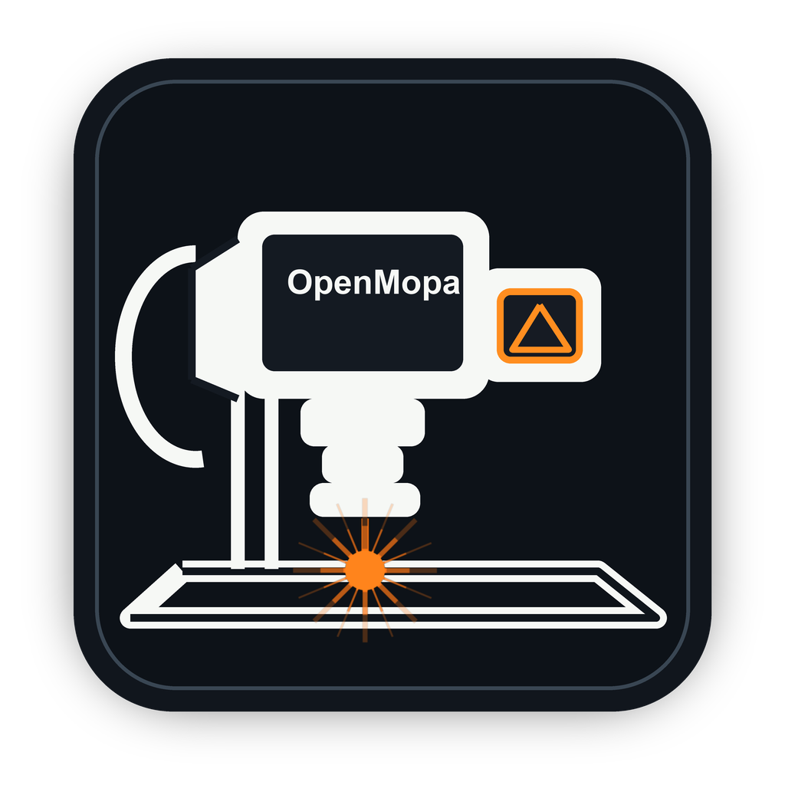

# OpenLaser

<p align="center">
  
</p>

OpenLaser is an open-source workspace for preparing jobs for:

- JPT MOPA fiber galvo lasers using JCZ/BJJCZ LMC controllers.
- GRBL-compatible CO₂ laser cutters.
- GRBL-compatible diode lasers.
- GRBL-compatible pen plotters.

You can import artwork, arrange it on the machine bed, assign operations and
settings to layers, preview the job, and either run it directly or export
G-code.

> [!IMPORTANT]
> OpenLaser is early-stage software that controls equipment capable of causing
> fires, eye injuries, burns, fumes, and machine damage. Never leave a running
> machine unattended. Wear the correct laser safety protection, use ventilation,
> keep a suitable fire extinguisher nearby, and test at low power first.

## What works today

| Machine | What OpenLaser does | How the job reaches the machine |
| --- | --- | --- |
| JPT M7 MOPA, 200 mm galvo | Import, plan, red-light frame, and mark | Direct JCZ/LMC USB control |
| GRBL CO₂, 600 × 400 mm | Import, plan, raster/vector processing, and G-code export | Open the exported file in your trusted GRBL sender |
| GRBL diode, 400 × 400 mm | Import, plan, raster/vector processing, and G-code export | Open the exported file in your trusted GRBL sender |
| GRBL pen plotter, A4 | Import, plan, and pen-motion G-code export | Open the exported file in your trusted GRBL sender |

The GRBL CO₂ profile is for controllers that accept normal GRBL G-code. It does
not control Ruida DSP controllers yet.

## Install OpenLaser

OpenLaser runs on **macOS, Windows, and Linux**. Each system has a one-step
installer, so you do not need to know programming or type commands.

| System | Installer to double-click / run | Start OpenLaser with |
| --- | --- | --- |
| macOS | `Install OpenLaser.command` | `OpenLaser.app` (drag it to the Dock) |
| Windows 10 / 11 | `Install OpenLaser.bat` | the **OpenLaser** shortcut on the Desktop and in the Start menu |
| Linux | `install-openlaser.sh` | **OpenLaser** in your applications menu |

### Step 1: Download OpenLaser (all systems)

1. Open the [OpenLaser GitHub page](https://github.com/luizbueno3d/OpenLaser).
2. Click the green **Code** button, then **Download ZIP**.
3. Unzip the downloaded file. You get a folder called `OpenLaser-main`. You
   may rename it to `OpenLaser`.
4. Move that folder to a permanent place, for example `Documents`.

Pick the final place now. The installed app and shortcuts point to this folder.
If you move it later, just run the installer again.

### Step 2: Install Python 3.10 or newer (if you do not have it)

The installers check for Python and tell you if it is missing.

- **macOS and Windows:** download Python from
  [python.org/downloads](https://www.python.org/downloads/) and run its
  installer. On **Windows**, tick **"Add python.exe to PATH"** on the first
  installer screen.
- **Linux:** use your package manager:
  - Ubuntu / Debian / Mint: `sudo apt install python3 python3-venv`
  - Fedora: `sudo dnf install python3`
  - Arch / Manjaro: `sudo pacman -S python`

### Step 3: Run the installer for your system

**macOS**

1. Open the OpenLaser folder.
2. Right-click (or Control-click) **Install OpenLaser.command** and choose
   **Open**. If macOS warns about an unidentified developer, choose **Open**
   again.
3. Wait for **Done! OpenLaser is installed**, then press any key.
4. Finder selects the new **OpenLaser.app**. Drag it to your **Dock** for
   one-click launching. Keep the real app inside the OpenLaser folder; the Dock
   icon is only a shortcut.

**Windows**

1. Open the OpenLaser folder.
2. Double-click **Install OpenLaser.bat**. If Windows SmartScreen says it
   protected your PC, click **More info**, then **Run anyway**.
3. Wait for **Done! OpenLaser is installed**, then press any key.
4. An **OpenLaser** shortcut is now on your Desktop and in the Start menu.
   Right-click it and choose **Pin to taskbar** for one-click launching.

**Linux**

1. Open a terminal in the OpenLaser folder (most file managers have
   **Open in Terminal** in the right-click menu).
2. Run `bash install-openlaser.sh`.
3. When it asks about the **USB permission rule**, answer **Y** if you use a
   JCZ/LMC MOPA laser. It asks for your password once. GRBL users can answer N.
4. **OpenLaser** now appears in your applications menu. Right-click it and
   choose **Add to Favorites** (or **Pin**) for one-click launching.

### Step 4: Start and stop OpenLaser

1. Start OpenLaser from the Dock, the Desktop/Start-menu shortcut, or the
   applications menu.
2. A small terminal window opens. **Leave it open** while you work; it is the
   OpenLaser engine.
3. Your default web browser opens OpenLaser at `http://127.0.0.1:8765`.

The browser only shows the interface. Everything runs on your own computer;
nothing is uploaded to a website. Starting OpenLaser again while it is already
running simply opens the browser again.

To **stop** OpenLaser, close that terminal window. Closing only the browser tab
does not stop it.

### Connecting a JCZ/LMC MOPA laser

GRBL CO₂, diode, and plotter users can skip this part: those machines get an
exported G-code file, not a direct USB connection.

- **macOS:** nothing extra to do. Plug in the laser and power it on.
- **Linux:** the installer's USB permission rule is all you need. If you
  skipped it, run the installer again, or run:

  ```bash
  sudo cp scripts/99-openlaser.rules /etc/udev/rules.d/99-openlaser.rules
  sudo udevadm control --reload-rules && sudo udevadm trigger
  ```

  Then unplug and replug the laser's USB cable once.
- **Windows:** the laser normally uses the EZCAD (BJJCZ) driver, which
  OpenLaser cannot use. Switch it to the free WinUSB driver once:
  1. Connect the laser by USB and power it on.
  2. Download **Zadig** from [zadig.akeo.ie](https://zadig.akeo.ie/) and open it.
  3. In the **Options** menu, enable **List All Devices**.
  4. Choose **USBLMCV4** in the list (USB ID `9588 9899`).
  5. Choose **WinUSB** as the target driver and click **Replace Driver**.

  > [!NOTE]
  > After this, **EZCAD can no longer use the laser on this PC** until you put
  > its driver back (Device Manager → USBLMCV4 → Update driver → choose the
  > BJJCZ driver, or reinstall EZCAD's driver). The direct USB path on Windows
  > has not yet been tested on real hardware by the maintainers; please report
  > your results in the GitHub issues.

To check the connection without sending any laser command, run `openlaser
detect` (see [Command-line tools](#command-line-tools)). It reports whether
your system sees the laser and, if something is missing, what to do next.

### Install with a terminal (developers)

```bash
git clone https://github.com/luizbueno3d/OpenLaser.git
cd OpenLaser
python3 -m venv .venv
source .venv/bin/activate        # Windows: .venv\Scripts\activate
python -m pip install --upgrade pip
python -m pip install -e .
openlaser ui
```

All dependencies install automatically, including `libusb-package`, which
provides the native USB library on macOS, Windows (x64), and Linux
(x86-64 / ARM64). On other platforms, such as 32-bit Raspberry Pi OS, install
your system's libusb instead (`sudo apt install libusb-1.0-0`).

Use `openlaser ui --no-browser` on a headless computer.

## How to use OpenLaser — your first job

The normal workflow is:

**Choose a machine → import artwork → position it → choose layers → enter
settings → plan → frame/verify → run or export.**

### Step 1: Choose your machine

Use the **Machine** menu at the top of the screen.

- Choose **JPT M7 MOPA · 200 mm galvo** for the original OpenMopa fiber setup.
- Choose **CO₂ cutter · GRBL 600 × 400 mm** for a GRBL CO₂ machine.
- Choose **Diode laser · GRBL 400 × 400 mm** for a GRBL diode machine.
- Choose **Pen plotter · GRBL A4** for the built-in A4 plotter profile.

The canvas changes to the selected machine's work area. Choosing the correct
machine is important because OpenLaser rejects artwork outside that area.

### Step 2: Import your artwork

1. Find **Import** in the left panel.
2. Click **Choose File**.
3. Select an `.svg`, `.dxf`, or `.stl` file.
4. Wait for the artwork to appear on the canvas.
5. Click **Fit** if the artwork is off-screen or very small.

DXF is the most complete CAD import path. Basic SVG line commands are supported,
but SVG Bezier curves and arc commands are not flattened yet. If a complicated
SVG imports incorrectly, convert its curves to polylines in your design program
or export DXF.

### Step 3: Select and position the artwork

- Click an object to select it.
- Shift-click to add or remove objects from the selection.
- Drag an empty area to draw a selection window.
- Double-click a line to select its connected shape.
- Use **X mm** and **Y mm** to position selected artwork.
- Use **Scale** to resize it.
- Use **Rotate deg** to rotate it.
- Click **Center Selection** to put the selected artwork at the bed center.
- Press Delete or Backspace to remove selected artwork.
- Use the mouse wheel to zoom.
- Hold Space and drag to pan.
- Press `f` to fit the artwork on screen.
- Press `0` to return to the full machine view.
- Undo with Command-Z (macOS) or Ctrl-Z (Windows / Linux). Redo with Shift-Command-Z, Ctrl-Y, or Shift-Ctrl-Z.

The design coordinate origin is the center of the displayed work area.
OpenLaser converts it to the positive coordinates used by GRBL during export.

### Step 4: Put artwork on a layer

Layers tell OpenLaser what to do with each object.

1. Select one or more objects.
2. Click the desired row in **Cuts / Layers**.
3. Click the arrow button marked **→**.

The default layers are:

| Layer | Meaning |
| --- | --- |
| Vector Engrave | Follow the imported lines with the laser/tool |
| Vector Cut / Deep Mark | Follow the imported lines, normally more slowly or with more passes |
| Raster | Fill closed shapes with closely spaced scan lines |
| Frame Only | Include the shape while framing, but do not output it while marking |

You can rename layers, change their color, reorder them, hide them, or disable
their output.

### Step 5: Choose the layer settings

Click a layer to edit its settings.

- **Mode:** vector engrave, vector cut, raster engrave, frame only, or disabled.
- **Speed mm/s:** how fast the tool moves while working.
- **Power %:** laser output from 0 to 100 percent.
- **Passes:** how many times to repeat the path.
- **Frequency kHz:** MOPA pulse frequency. Only shown for compatible machines.
- **Pulse ns:** MOPA pulse width. Only shown for compatible machines.
- **Pitch mm:** distance between raster fill lines. Smaller values produce more
  lines and a longer job.
- **Hatch angle:** direction of raster fill lines.
- **Angle step/pass:** rotation added to the hatch angle on each raster pass.
- **Air assist:** emits `M8`/`M9` for compatible GRBL laser profiles.

There is no universal safe power or speed. Correct values depend on the exact
laser, material, focus, lens, cooling, air assist, and desired result. Start
with a small test piece and settings recommended by your machine or material
supplier. Do not copy MOPA settings into a CO₂ or diode machine.

For a pen plotter, laser power, frequency, and pulse width are hidden because
the pen does not use them.

### Step 6: Plan the job

Click **Plan Job** before every run or export.

Planning checks:

- Whether there is usable geometry.
- Which layers will produce output.
- The job's bounding box.
- Layer settings.
- Whether every point fits inside the selected machine.
- MOPA emission safety requirements when using direct control.

Read the **Activity** and **Job Summary** panels. Fix every reported error before
continuing.

### Step 7A: Run a MOPA job directly

This path is only for the built-in JCZ/LMC JPT M7 profile.

1. Make sure the machine, enclosure, extraction, and safety equipment are ready.
2. Connect USB and power on the machine.
3. Click **Frame Once** to trace the job with the red aiming light.
4. Confirm the frame is entirely inside the fixture/material.
5. Recheck every layer's power, frequency, pulse width, speed, and passes.
6. Type `ARM` exactly in the ARM box. It clears when the dialog closes, so type
   it again for every job.
7. Click **Mark Job**.
8. Read the final confirmation dialog: one row per layer with the power,
   frequency, pulse width, actual speed and passes that layer will burn with.
9. Confirm only when the area is safe and you are ready for emission. The
   confirmation is valid for this exact job for 60 seconds, once.
10. Stay with the machine until the job finishes.

Use **Start Continuous Frame** only while positioning. Click **Stop Frame** when
finished. Use the red **STOP ENGRAVING** button if the job must stop immediately.

### Step 7B: Export a CO₂ or diode laser job

OpenLaser currently creates the job file; your normal GRBL sender communicates
with the machine.

1. Click **Plan Job** and correct every error.
2. Click **Export G-code**.
3. Save the `.gcode` file somewhere easy to find.
4. Open your trusted GRBL sender.
5. Connect the sender to the correct machine and serial port.
6. Load the exported `.gcode` file.
7. Confirm units are millimetres and the job fits the machine bed.
8. Use the sender's frame/boundary feature with the laser safely disabled or at
   its approved framing power.
9. Recheck origin, focus, material, ventilation, cooling, and air assist.
10. Start the job from the sender and remain with the machine.

The CO₂ profile uses constant-power `M3`. The diode profile uses dynamic-power
`M4`. Laser power is scaled to the built-in GRBL range of `S0` through `S1000`.
Confirm that this matches your controller's `$30` configuration before use.

### Step 7C: Export a pen plotter job

1. Select **Pen plotter · GRBL A4**.
2. Import and position the artwork.
3. Assign it to an output layer and set speed/passes.
4. Click **Plan Job**.
5. Click **Export G-code**.
6. Load the file in your GRBL sender.
7. Test pen-up and pen-down commands with the pen away from the paper.
8. Frame or dry-run the movement.
9. Install the pen and start the job.

The built-in plotter profile uses `M3 S1000` for pen down and `M5` for pen up.
Plotter firmware and servo arrangements vary. Verify those commands on your
machine before allowing the pen to touch the paper.

## Raster engraving explained simply

Vector modes follow the outlines in your file. Raster mode fills the inside of
a closed shape with parallel lines.

For raster fill to work:

1. The shape must be closed; its final point must return to its first point.
2. The Raster layer must have **Output** enabled.
3. Pitch must be greater than zero.

Open raster paths are skipped and reported. A smaller pitch creates more fill
lines, higher density, and a longer job.

## Selected-only jobs, mirroring, and repeats

- Enable **Selected only** to plan, frame, mark, or export only selected objects.
- Enable horizontal or vertical mirroring when the job or material requires it.
- Use **Repeat** to repeat the full job. Be extremely careful with repeat counts
  on lasers because heat accumulates between repetitions.

## Calibration for the MOPA galvo

The Advanced panel includes **Scale correction** for the direct MOPA profile.

1. Mark a square of a known intended size.
2. Measure the actual marked square accurately.
3. Calculate `measured size ÷ intended size`.
4. Enter that number as Scale correction.

Example: a 50 mm square measures 59.17 mm. Enter `1.1834`.

A correction above 1 lets the galvo reach past the lens's rated field, but the
work area stays the profile's `FIELDSIZE` (200 mm for the JPT M7 profile):
artwork outside ±100 mm is refused for both Frame and Mark.

Calibration is stored locally in `calibration.json`. OpenLaser does not modify
your original JCZ correction or mark configuration files.

## Where OpenLaser saves your work

OpenLaser keeps these files beside the project:

- `workspace.json`: imported objects and their transforms.
- `layer_settings.json`: layer names, modes, and parameters.
- `calibration.json`: local MOPA scale correction.

These machine-local files are ignored by Git. The workspace is saved
automatically after changes.

## Troubleshooting

### macOS says the installer cannot be opened

Right-click **Install OpenLaser.command**, choose **Open**, and then choose
**Open** again in the warning dialog. Double-clicking alone may be blocked by
Gatekeeper the first time.

### Windows says it "protected your PC"

That is SmartScreen, which warns about any downloaded script. Click
**More info**, then **Run anyway**.

### The installer says Python is missing

Follow [Step 2](#step-2-install-python-310-or-newer-if-you-do-not-have-it),
then run the installer again. On Windows, if Python is installed but still not
found, run the Python installer again, choose **Modify**, and make sure
**Add Python to environment variables** is ticked.

### Linux says the `venv` module is missing

Ubuntu and Debian ship Python without it. The installer prints the exact
command, for example `sudo apt install python3.12-venv`. Run it, then run the
installer again.

### The browser did not open

Leave the OpenLaser terminal window running and manually open:

```text
http://127.0.0.1:8765
```

### The page says “Server connection lost”

The terminal window running OpenLaser was probably closed. Start OpenLaser
again from the Dock, shortcut, or applications menu.

### `openlaser: command not found`

Activate the private environment first:

```bash
cd OpenLaser
source .venv/bin/activate        # Windows: .venv\Scripts\activate
openlaser ui
```

### MOPA hardware is not detected

1. Check machine power.
2. Reconnect the USB cable.
3. Try another cable or USB adapter.
4. Activate the environment and run `openlaser detect`.

Detection does not send laser commands. Its `hint` line says what to do next:

- **Windows sees the laser but OpenLaser cannot open it:** install the WinUSB
  driver with Zadig; see
  [Connecting a JCZ/LMC MOPA laser](#connecting-a-jczlmc-mopa-laser).
- **Linux sees the laser but permission is denied:** install the USB
  permission rule from the same section, then replug the laser.
- **libusb could not be loaded:** run the installer again.

### The JCZ/LMC controller connects but does not respond

The controller can become wedged if a process stops during a USB transfer.
Turn the complete laser machine off, wait at least 15 seconds, and turn it on
again. Unplugging only the USB cable is not enough because the controller is
powered by the machine.

### Export says geometry is outside the work area

OpenLaser intentionally refuses to clip the job. Select the correct machine,
then move or scale the artwork until it is fully inside the visible bed.

### Raster produces no lines

The source shape is probably open. Join its endpoints in your CAD program or
use **Join Connected Lines** with an appropriate tolerance.

### The plotter does not lift or lower the pen

Your controller may use different servo commands. The built-in profile expects
`M3 S1000` for down and `M5` for up. Test safely and customize the machine
profile in code before running a real drawing.

## Command-line tools

Activate `.venv` before using these commands.

```bash
openlaser machines
openlaser detect
openlaser show-config
openlaser pulse-widths
openlaser inspect-profile
openlaser plan-test-box --power 10 --frequency-khz 30 --pulse-width-ns 200
openlaser ui
```

`openmopa` remains available as a compatibility alias, but new documentation
uses `openlaser`.

## Test without hardware

Mock mode exercises the MOPA software chain without contacting a real board:

```bash
OPENMOPA_MOCK=1 openlaser ui          # macOS / Linux
set OPENMOPA_MOCK=1 && openlaser ui   # Windows Command Prompt
```

Results clearly report `"mock": true`.

## Supported platforms

| | macOS | Windows 10 / 11 | Linux |
| --- | --- | --- | --- |
| Installer and launcher | ✅ tested | ✅ written; not yet run on a Windows PC by the maintainers | ✅ tested (Ubuntu 24.04) |
| Design, planning, G-code export | ✅ | ✅ | ✅ |
| Direct JCZ/LMC MOPA control | ✅ tested on hardware | ⚠️ needs the WinUSB driver; untested on hardware | ⚠️ needs the udev rule; untested on hardware |

The test suite runs on macOS and Linux. Please report Windows and Linux
hardware results in the GitHub issues so this table can be updated.

## Safety rules enforced by OpenLaser

For direct MOPA emission:

- Power must be between 0 and 100 percent.
- Frequency must be inside the machine profile limits.
- Pulse width must match the machine profile's allowed table.
- At least one markable path must exist.
- Every point must lie inside the work area: the lens's rated field, or the
  calibrated galvo reach if that is smaller. Points outside are refused, never
  clamped.
- A layer speed that the controller would encode as 0 (below about 3.6 mm/s at
  the calibrated field) is refused, with the minimum named.
- A hidden layer with Output on is refused, because framing skips it.
- An object on a layer that does not exist, or a point that is not (x, y), is
  refused rather than dropped.
- The operator must type `ARM`, and the final confirmation sends a single-use
  token issued for that exact job; it expires after 60 seconds.
- Only one OpenLaser process may drive the board at a time
  (`~/Library/Application Support/OpenLaser/board.lock` on macOS).
- If the board stops making progress (no READY or idle within a budget derived
  from the job's estimated time), the job is stopped, never continued:
  StopExecute, MO closed, ports off.

Set `OPENMOPA_USB_TRACE=/path/to/trace.jsonl` before starting OpenLaser to
record a timestamped trace of every USB command and status reply.

For GRBL export:

- Coordinates must be finite.
- Every coordinate must fit inside the selected work area.
- Layer power must be between 0 and 100 percent.
- Layer speed must be greater than zero and is capped to the machine profile.
- The generated file begins in millimetres and absolute coordinate mode.
- Tool-off commands are inserted before travel and at the end of the job.

Software checks do not replace machine interlocks, enclosure switches,
ventilation, fire prevention, training, or operator attention.

## Current limitations

- Direct USB control currently targets the original JCZ/LMC MOPA setup only.
- GRBL CO₂, diode, and plotter jobs are exported rather than streamed directly.
- Ruida DSP controllers are not supported.
- Built-in gantry bed sizes and plotter commands are not yet editable in the UI.
- SVG import supports line-oriented `M`, `L`, `H`, `V`, and `Z` paths; complex
  curves should be flattened before import.
- Windows and Linux direct MOPA control need real-machine validation.
- On Windows, the laser cannot be shared with EZCAD while it uses the WinUSB
  driver.

## Development

Run the complete test suite with:

```bash
source .venv/bin/activate        # Windows: .venv\Scripts\activate
python -m unittest discover -v
```

Important modules:

```text
mopa_luiz/machines.py   built-in machine profiles and capabilities
mopa_luiz/gcode.py      GRBL laser and plotter G-code compiler
mopa_luiz/layers.py     layer model and operation grouping
mopa_luiz/raster.py     hatch-fill generation
mopa_luiz/safety.py     direct-emission safety policy
mopa_luiz/live.py       JCZ/LMC direct-control path
mopa_luiz/usb_backend.py  finds a libusb library on every platform
mopa_luiz/ui.py         local HTTP server and browser interface
```

Installers: `Install OpenLaser.command` (macOS), `Install OpenLaser.bat`
(Windows), `install-openlaser.sh` (Linux). `.gitattributes` keeps their line
endings correct for each system.

The Python package still uses the internal `mopa_luiz` name for compatibility
with the original OpenMopa codebase.

## License and security

OpenLaser is released under the [MIT License](LICENSE).

Please read [SECURITY.md](SECURITY.md) before reporting a security issue.
